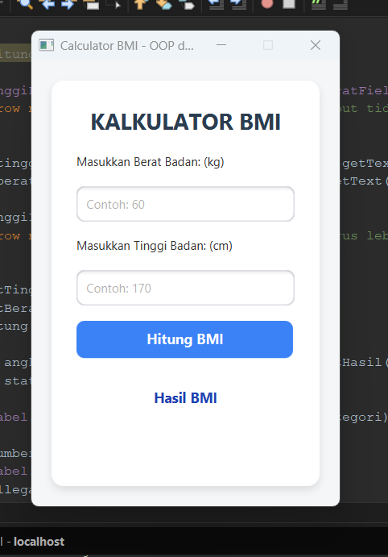

## Kalkulator BMI (Body Mass Index) - JavaFX

Aplikasi desktop interaktif untuk menghitung **Body Mass Index (BMI)** berbasis **JavaFX** dan dikembangkan menggunakan arsitektur **MVC (Model-View-Controller)**. Aplikasi ini membantu pengguna mengetahui status berat badan ideal (Standar WHO) secara praktis berdasarkan standar kriteria kesehatan.

---

## Tampilan Aplikasi

  

---

## Fitur Utama

- **Kalkulasi Akurat**: Menghitung indeks massa tubuh berdasarkan tinggi (cm) dan berat badan (kg).
- **Kategori Status Otomatis**: Menampilkan status BMI (Kurus, Ideal, Gemuk, Obesitas).
- **Validasi Input & Error Handling**: Mencegah kesalahan input (kolom kosong, huruf/karakter tidak valid, serta angka $\le 0$).
- **Antarmuka Modern**: Tampilan GUI yang bersih dan responsif didesain menggunakan **Scene Builder**.

---

## Kategori Status BMI WHO

| Rentang BMI | Kategori | Detail Deskripsi |
| :---: | :---: | :--- |
| **< 18.5** |  **Kurus** | *Underweight* (Kurang Berat Badan) |
| **18.5 – 24.9** |  **Ideal** | *Normal Weight* (Berat Badan Ideal) |
| **25.0 – 29.9** |  **Gemuk** | *Overweight* (Kelebihan Berat Badan) |
| **≥ 30.0** |  **Obesitas** | *Obese* (Sangat Kelebihan Berat Badan) |

---

## Teknologi & Tools

- **Bahasa Pemrograman**: Java (JDK 17/21)
- **GUI Framework**: JavaFX
- **Build Tool**: Maven
- **IDE**: NetBeans
- **Design Tool**: Scene Builder

## Cara Menjalankan Aplikasi
Prasyarat
-JDK 17 atau versi lebih baru
-Apache Maven
-NetBeans IDE (disarankan versi 12+)

Langkah Eksekusi
1. Clone repository:

git clone (https://github.com/Irayha/Latihan-Kalkulator-BMI)

2. Buka Proyek di NetBeans:
- Buka NetBeans IDE.
- Pilih File > Open Project...
- Arahkan dan buka folder KalkulatorBMI.

3. Build & Run:
- Klik kanan pada proyek di panel Projects.
- Pilih Clean and Build.
- Klik kanan pada file Main.java di dalam package main, lalu pilih Run File (atau jalankan via F6).

Proyek ini dibuat untuk tujuan pembelajaran Pemrograman Lanjut / Object-Oriented Programming (OOP) dan GUI
